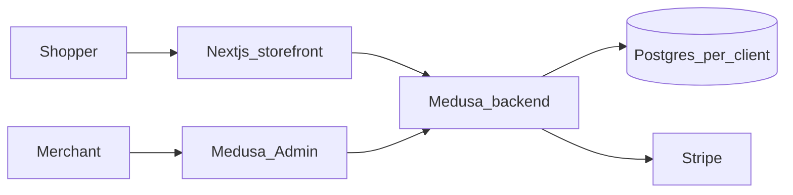

# Ponytail audit — Retail Starter V1

Date: 2026-10-27  
Scope: whole repository  
Load assumed: one SMB client store, roughly 10–50 concurrent shoppers, one Medusa process + PostgreSQL — not Shopify-scale multi-tenant traffic.

## What this repo does

`retail-starter` is a reusable B2C store foundation: a Next.js storefront and a Medusa commerce backend with one dedicated PostgreSQL database per client deployment. Shoppers browse the catalog, keep a guest cart, check out, and pay with Stripe. Merchants use Medusa Admin for products, orders, refunds, and basic settings.

Documented phase status: all 17 phases of `docs/implementation-plan.md` are marked complete; `docs/release-readiness-v1.md` marks V1 production-ready. Runtime wiring of several phase modules is thinner than the docs imply (see findings).

## Phase vs Shopify-like goal

| | This repo today | Shopify-like platform |
| --- | --- | --- |
| Model | Agency / white-label starter: redeploy per client | Multi-tenant SaaS: one platform, many merchants |
| Isolation | One DB + credentials + Stripe account per client | Shared infra; tenant isolation inside the product |
| Onboarding | Operator configures brand, catalog, shipping, tax | Merchant signup, provisioning, billing, themes/apps |
| Code status | V1 commerce path largely built | Platform layer not started |

Closest honest label: finished **v1 store engine + storefront template** for one brand at a time — not a Shopify clone.

Known platforms for comparison:

- **Shopify:** hosted multi-tenant SaaS; merchant self-serve.
- **WooCommerce:** one WordPress site ≈ one store; you host.
- **Medusa (this stack):** headless commerce engine; multi-tenant needs an extra platform layer (provisioning, tenant registry, billing).

**Business-model decision (user-confirmed):** copy the codebase folder per business; change brand/presentation (+ catalog data and secrets); leave functional commerce features unchanged. Isolated deploy per copy. Not multi-tenant SaaS.

---

## Findings

### Must fix

1. **Production email is a test sink** (`apps/backend/medusa-config.ts` L49–61)
   - **What this is:** Order/payment notifications go through `notification-test-sink`.
   - **Problem:** Real customers and admins never get email with this config.
   - **Fix:** Wire a real transactional email provider; keep existing idempotency helpers.
   - **If we skip it:** Orders can succeed while nobody is notified — first client launch fails operationally.

2. **Refund / fulfill / restock idempotency not durable or HTTP-wired** (`apps/backend/src/workflows/refunds/process-order-refund.ts`, fulfillment and returns workflows)
   - **What this is:** Domain helpers can reuse `existingRefund` / similar records, but steps never load them; no custom API routes call these workflows.
   - **Problem:** Retries can double-refund or double-adjust stock if these workflows are used; today ops likely use Medusa Admin only.
   - **Fix:** Persist idempotency keys and short-circuit before provider/inventory calls — or delete unused custom paths and document Admin-only.
   - **If we skip it:** Safe only while nobody calls the custom workflows; dangerous if automation hooks them later.

3. **Reconciliation is in-memory only** (`apps/backend/src/modules/recovery/service.ts`)
   - **What this is:** `ReconciliationService` uses a process-local `Map` and is not hooked to checkout/payment failures.
   - **Problem:** Paid-without-order and ambiguous payment cases do not survive restart; no durable ops queue in this code.
   - **Fix:** Persist reconciliation records and record events from payment mismatch / complete failures — or accept Stripe Dashboard + Medusa Admin as the only runbook and document it.
   - **If we skip it:** Support hunts “money in Stripe, no order” by hand after every deploy.

4. **Stale PaymentIntent can charge without order** (`apps/storefront/src/lib/medusa/checkout-payment.ts`, Stripe payment form)
   - **What this is:** Complete is blocked when session amounts do not match the cart; old client secrets can still be paid in another tab.
   - **Problem:** Customer pays a stale amount; order creation refuses → captured funds with no order until manual reconcile.
   - **Fix:** Invalidate or refresh sessions when cart totals change; shorten session lifetime; record mismatch for ops.
   - **If we skip it:** Recurring support tickets on concurrent tabs or slow checkout.

### Should fix

5. **`pending_authorization` stalls checkout** (`apps/storefront/src/app/components/checkout-form.tsx`)
   - Slow or missed Stripe→Medusa webhooks leave a “refresh only” UI; finalize needs `authorized` / `captured`.
   - **Fix:** Ensure webhooks in production; optional poll/finalize job.
   - **If we skip it:** Abandoned carts and support load under webhook lag.

6. **No durable deploy artifacts for apps**
   - Compose covers Postgres/MinIO only (`infra/docker-compose.yml`); no Dockerfile or PaaS blueprint for backend + storefront.
   - **Fix:** Minimal deploy recipe per client matching the isolated-deploy ADRs.
   - **If we skip it:** Each client launch stays bespoke and error-prone.

7. **Large phase modules tested but not wired to startup**
   - Deployment gates, lifecycle CAS, readiness checker, bulk-import/media workflows exist as unit-tested libraries, not hooked into `medusa-config`, custom API, or jobs.
   - **Fix:** Wire the paths operators will actually run, or mark/trim as non-runtime until needed.
   - **If we skip it:** Docs say “production ready” while operators cannot run those gates from the running app.

8. **Test gaps on money-path edges**
   - Strong coverage for payment-session locking and checkout state.
   - Missing: Stripe webhook integration test, full `cart.complete` HTTP path, browser E2E, custom refund workflow HTTP.
   - **Fix:** One webhook + one happy-path complete integration; optional Playwright later.
   - **If we skip it:** Regressions land in production Stripe flows.

9. **Guest cart IDOR surface** (Medusa guest model + publishable key)
   - Anyone holding a `cart_id` can mutate that cart within sales-channel scope.
   - **Fix:** Keep IDs secret and HttpOnly (already); rate-limit; avoid logging cart IDs.
   - **If we skip it:** Accept the industry guest-cart risk for SMB.

### Nice to have

10. **Storefront inventory check is advisory** — oversell races are deferred to Medusa at `cart.complete`.
11. **Completed-order endpoint** returns limited public order facts for a completed cart id — acceptable if cart IDs stay high-entropy.
12. **Trim dead jobs folder / unused workflow surface** once Admin-only vs custom ops APIs is decided.

---

## Lean

Roughly hundreds of lines of test-only deployment / lifecycle / recovery / backend-presentation code could be deferred or deleted until wired. No extra product dependencies are required for the SMB per-client model. A multi-tenant SaaS layer would add substantial surface.

## Not checked

Medusa core internals in `node_modules`, full Admin UI extensions, live load testing, dependency CVE audit, privacy CAS runtime path end-to-end, and catalog UI polish.

## Verdict

Strong checkout payment-session engineering for an SMB starter; **not yet first-client-ready** until real email and a payment-mismatch runbook (preferably with durable reconcile) are real. Docs oversell “all phase modules live in production” relative to wiring. Versus a Shopify-like SaaS goal: **engine complete / platform missing**.

Follow-up prioritization: `docs/client-delivery-next-steps.md`.
